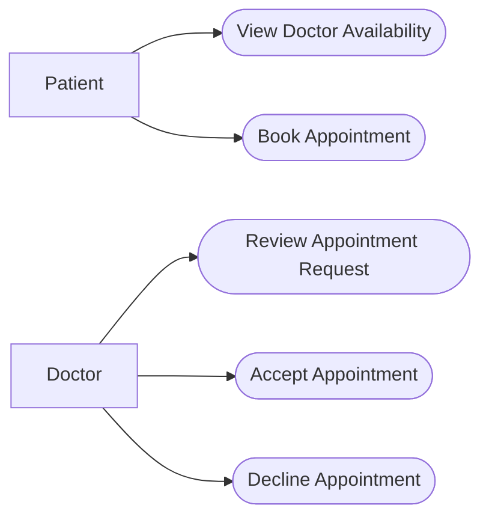

# 2. Use Cases — Doctor Appointment Booking System

## 2.1 Actors

- **Patient:** Views doctors' availability and requests appointments.
- **Doctor:** Reviews appointment requests and accepts or declines them.

## 2.2 Use Cases

| ID | Actor | Use Case | Description |
|---|---|---|---|
| UC-01 | Patient | View Doctor Availability | The patient views the days and times when a doctor is available. |
| UC-02 | Patient | Book Appointment | The patient requests an appointment during an available time slot. |
| UC-03 | Doctor | Review Appointment Request | The doctor views a pending appointment request. |
| UC-04 | Doctor | Accept Appointment | The doctor accepts a pending appointment request. |
| UC-05 | Doctor | Decline Appointment | The doctor declines a pending appointment request. |

## 2.3 Main Flow — Book Appointment

**Actor:** Patient

**Precondition:** The patient can access the appointment booking system.

1. The patient selects a doctor.
2. The system displays the doctor's available days and times.
3. The patient selects an available time slot.
4. The system checks the patient's upcoming appointment limit.
5. The system checks that the selected slot is still available.
6. The system creates a pending appointment request.
7. The system confirms that the request was submitted.

**Postcondition:** A pending appointment request exists for the selected time slot.

## 2.4 Alternative Flow — Appointment Limit Reached

At Step 4 of the main flow:

1. The system finds that the patient already has N upcoming appointments with Pending or Accepted status.
2. The system rejects the booking request.
3. The system informs the patient that the appointment limit has been reached.

**Postcondition:** No new appointment is created.

## 2.5 Alternative Flow — Slot No Longer Available

At Step 5 of the main flow:

1. The system finds that the selected slot is no longer available.
2. The system informs the patient that the slot cannot be booked.
3. The patient may select another available slot.

**Postcondition:** No appointment is created for the unavailable slot.

## 2.6 Use Case Diagram

Note: The diagram uses a Mermaid flowchart to represent the actors and use cases.
