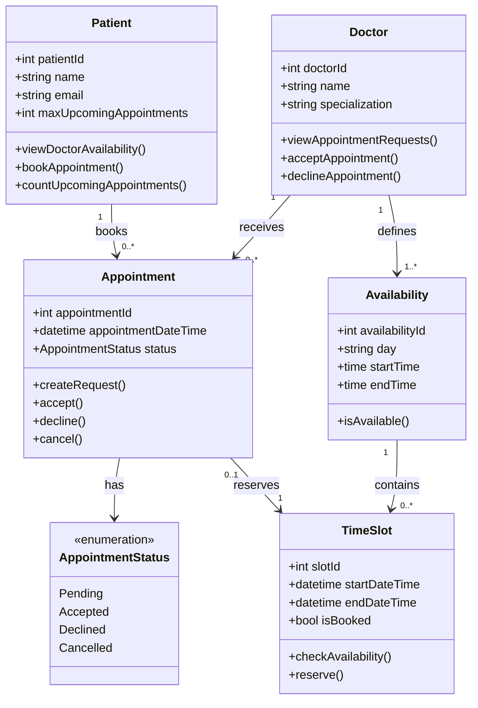

# 4. Class Diagram — Doctor Appointment Booking System

## 4.1 Overview

The class diagram represents the main classes required for the Doctor Appointment Booking System. It is based on the system requirements, use cases, and candidate-class analysis.

## 4.2 Class Diagram

## 4.3 Class Responsibilities

| Class | Responsibility |
|---|---|
| Patient | Views doctor availability and requests appointments. Tracks the patient's upcoming appointment limit. |
| Doctor | Defines availability and accepts or declines pending appointment requests. |
| Appointment | Represents a booking request and maintains its status and scheduled date and time. |
| Availability | Represents the days and time ranges when a doctor is available. |
| TimeSlot | Represents a specific bookable time interval and its availability. |
| AppointmentStatus | Defines the possible states of an appointment. |

## 4.4 Design Rules

1. A patient can have at most N upcoming appointments with Pending or Accepted status.
2. For this project, N = 3.
3. Declined, Cancelled, and past appointments do not count toward the limit.
4. An appointment can be requested only for an available time slot.
5. A doctor can accept or decline a pending appointment request.
6. The system must prevent two appointments from reserving the same time slot.

## 4.5 Relationship Explanation

- A Patient can book multiple appointments.
- A Doctor can receive multiple appointment requests.
- A Doctor defines one or more availability periods.
- An Availability period contains multiple time slots.
- Each Appointment has an AppointmentStatus.
- An Appointment is associated with the time slot it requests.
