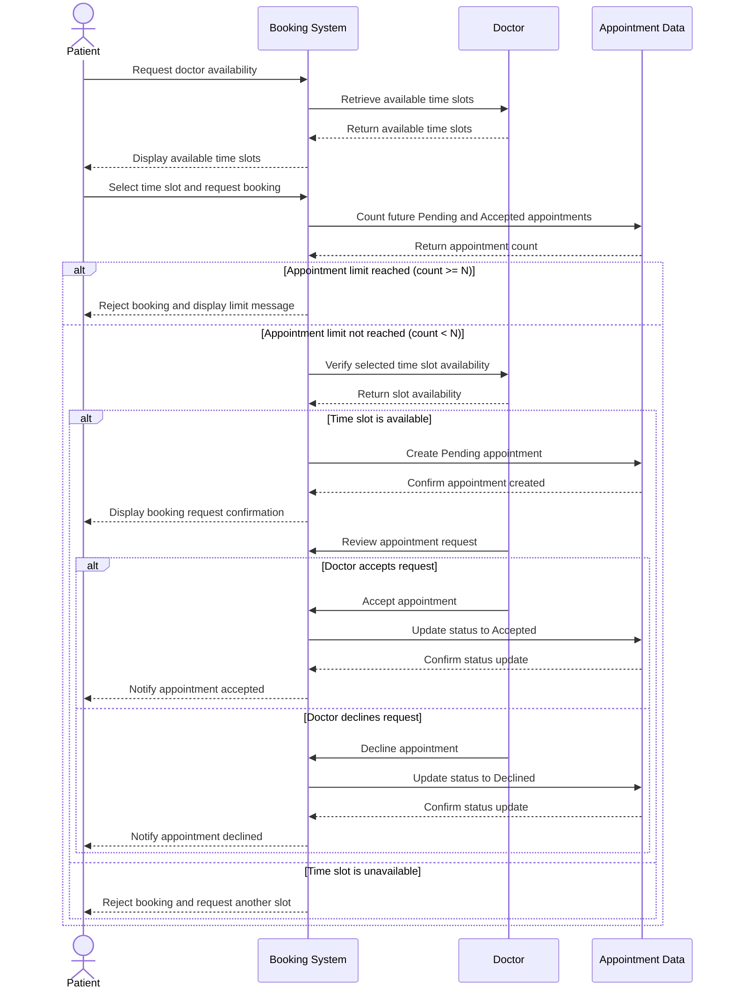

# 5. Sequence Diagram — Doctor Appointment Booking System

## 5.1 Overview

This sequence diagram illustrates the appointment booking process between the Patient, the booking system, the Doctor, and the appointment data.

It includes alternative outcomes for a patient who reaches the appointment limit and a time slot that is no longer available.

## 5.2 Appointment Booking Sequence

## 5.3 Participants

| Participant | Responsibility |
|---|---|
| Patient | Requests availability and submits an appointment booking request. |
| Booking System | Coordinates availability checks, appointment limits, and booking decisions. |
| Doctor | Provides availability and accepts or declines appointment requests. |
| Appointment Data | Counts relevant appointments, creates appointments, and updates their status. |

## 5.4 Alternative Scenarios

1. **Appointment limit reached:** If the patient already has N future appointments with Pending or Accepted status, the system rejects the booking.
2. **Time slot unavailable:** If the slot is no longer available, the system rejects the request and asks the patient to select another slot.
3. **Doctor accepts:** The appointment status changes from Pending to Accepted.
4. **Doctor declines:** The appointment status changes from Pending to Declined.

## 5.5 Consistency Rules

- The maximum number of upcoming appointments is N = 3, consistent with the requirements and class diagram.
- Only future Pending and Accepted appointments count toward the limit.
- Declined, Cancelled, and past appointments do not count toward the limit.
- A booking request is created only after the system verifies the appointment limit and time-slot availability.
